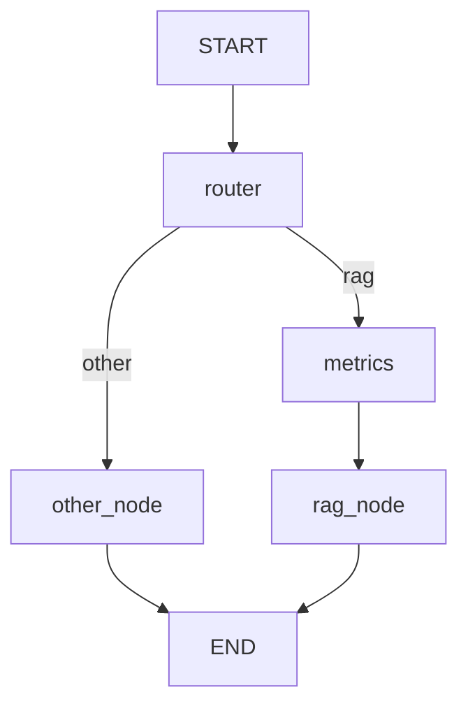

# SEC 10-K Q&A: RAG + LangGraph

Question answering over SEC 10-K filings of Apple, Microsoft and Amazon.
Narrative questions go through RAG over filing text, numeric questions go through exact XBRL data.

## What it does

- **Metric:** "What is Apple's revenue in 2023?" → Apple's 2023 revenue is 383,285,000,000 USD (exact figure from XBRL)
- **Comparison:** "Compare Apple's and Microsoft's revenue in 2023" → a table with both figures (383.3B vs 211.9B USD) and the difference
- **Narrative:** "Tell me about Microsoft's strategy" → a summary built from retrieved FY2025 10-K excerpts
- **Out of scope:** greetings, other companies (e.g. Tesla, Google) → a fixed refusal, no LLM call for the answer


## Architecture



- **router.py**: LLM with structured output (companies, year, question type, metric)
- **metric_tool.py**: exact numbers from XBRL facts (revenue, net income)
- **retriever.py**: Qdrant + bge-small-en embeddings, per-company search
- **RAG.py**: prompts and answer generation
- **graph.py**: LangGraph pipeline

Why two sources: LLMs and text chunks are unreliable for exact numbers, so figures come straight from XBRL and are marked in the prompt as the trusted source. Filing text is used only for explanations, risks and strategy. For comparisons the retriever searches each company separately, so one company's text can't push out another's.

## Scope and limitations

- Text search (risks, strategy, etc.): **FY2025 filings only**
- Metrics: revenue and net income, **any year** available in XBRL
- If no year is given in a metric question, the latest available fiscal year is used
- Other companies and off-topic questions get a fixed refusal
- Uses a free OpenRouter model, so rate limits apply
- Each question costs 2 LLM calls (router + answer), refused questions cost 1

## Test results

20 test questions, see `test.py` and `test_results.json`.

| Question | Status | Comment |
|---|---|---|
| Привет, как дела? | OK |  |
| Какая выручка у Tesla в 2023? | CHECK | type: expected other, got metric |
| Расскажи анекдот | OK |  |
| Какие риски у Google? | OK |  |
| Какая выручка у Apple в 2023? | OK |  |
| What was Microsoft's net income in 2022? | OK |  |
| Чистая прибыль Amazon за 2021 и 2023 | OK |  |
| Какая выручка у Apple? | CHECK | metrics: expected False, got True |
| Какие основные риски у Amazon в 2023? | OK |  |
| Why did Apple's revenue change in 2022? | OK |  |
| Расскажи про стратегию Microsoft | OK |  |
| Какие риски указаны в отчётах? | OK |  |
| Сравни выручку Apple и Microsoft в 2023 | OK |  |
| Чем отличаются риски Amazon и Apple? | OK |  |
| Что общего у всех трёх компаний в плане конкуренции? | OK |  |
| Какая выручка у Apple в 2035? | OK |  |
| Какая прибыль у Apple в прошлом году? | CHECK | metrics: expected False, got True |
| Сколько сотрудников у Amazon в 2023? | OK |  |
| iPhone vs Mac: что приносит больше выручки? | OK |  |
| ? | OK |  |

### Analysis

Routing and precise figures work well. Off-topic questions, mentions of other companies, and nonsensical queries are rejected after just one query to the LLM. For questions specifying a year, the figures from XBRL are always correct, even when referring to multiple years or multiple companies. If no year is specified, the system uses the most recent fiscal year for each company. If the search yields no useful results, the system reports this rather than making things up.

The biggest problem is the free model: it sometimes gets the numbers wrong. The data we provide is correct, but Amazon’s net income came out 10 times higher than it actually is, and the comparison text listed incorrect totals below the correct table. The search function also leaves much to be desired: text snippets are short (300 characters), so the text-based answers remain superficial; and if a company name isn’t included in the question, the results may be dominated entirely by a single company (a general question about risks yielded results for Microsoft only). Minor issues include: the phrase “last year” is not recognized and returns the latest available year; the message “only for fiscal year 2025” is used in other contexts as well; and the free version of the model sometimes adds foreign words and has strict limits on query speed.

The test checks only routing and has no correct answers for comparison, so an “OK” rating does not mean the response text is correct. The three lines marked “CHECK” are not errors: the test’s expectations are simply outdated or too strict. 

## Setup

1. `pip install -r requirements.txt`
2. Copy `.env.example` to `.env` and add your `OPENROUTER_API_KEY`
3. The cleaned 10-K text and XBRL facts are already in `data/`
4. The vector DB is already in `qdrant_data/`. Run `python Vectorizer.py` only if you want to rebuild it
5. Run tests: `python test.py`

Use a single Python process at a time: local Qdrant can't be opened by two processes at once.

Asking a single question:

```python
from graph import app

result = app.invoke({"question": "Какая выручка у Apple в 2023?"})
print(result["RAG_ans"])
```


## What's next

- Evaluation with RAGAS and tracing with LangSmith
- FastAPI wrapper
- Narrative search over more fiscal years
- Stronger LLM instead of the free tier